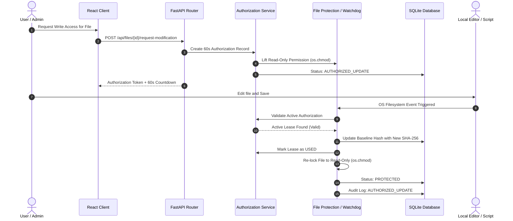

# File Tampering Detector (SecureFileGuard) 🛡️

[](https://www.python.org/)
[](https://fastapi.tiangolo.com/)
[](https://react.dev/)
[](https://vitejs.dev/)
[](https://www.sqlite.org/)
[](https://docs.pytest.org/)
[](https://en.wikipedia.org/wiki/SHA-2)
[](LICENSE)

> **File Tampering Detector** is a real-time host-based File Integrity Monitoring (FIM) and intrusion detection system. Built as a Cryptography & Network Security (CNS) project, it establishes cryptographic SHA-256 baselines, actively watches files for unauthorized tampering or deletions, enforces temporary time-bounded write leases, and maintains an immutable audit log with process attribution.

---

## 📑 Table of Contents

- [1. Problem Statement](#1-problem-statement)
- [2. System Overview & Core Capabilities](#2-system-overview--core-capabilities)
- [3. Security Objectives (CIA Triad & CNS Principles)](#3-security-objectives-cia-triad--cns-principles)
- [4. Architecture & System Flow](#4-architecture--system-flow)
  - [4.1 Architecture Diagram](#41-architecture-diagram)
  - [4.2 Tampering Detection Logic Flow](#42-tampering-detection-logic-flow)
  - [4.3 Authorized Modification Lifecycle](#43-authorized-modification-lifecycle)
- [5. Technology Stack](#5-technology-stack)
- [6. Database Schema](#6-database-schema)
- [7. API Reference](#7-api-reference)
- [8. Installation & Setup](#8-installation--setup)
  - [Prerequisites](#prerequisites)
  - [Step 1: Clone Repository](#step-1-clone-repository)
  - [Step 2: Backend Setup](#step-2-backend-setup)
  - [Step 3: Frontend Setup](#step-3-frontend-setup)
- [9. Running the Application](#9-running-the-application)
- [10. Step-by-Step Live Demo Scenarios](#10-step-by-step-live-demo-scenarios)
- [11. Automated Test Suite](#11-automated-test-suite)
- [12. Security Considerations & Limitations](#12-security-considerations--limitations)
- [13. Future Roadmap](#13-future-roadmap)
- [14. License](#14-license)

---

## 1. Problem Statement

Critical files on modern computer systems (configuration files, binaries, sensitive reports, and credentials) are continuously vulnerable to unauthorized alteration:
- **Malware & Ransomware:** Stealthily overwriting or corrupting files in place.
- **Insider Threats:** Unauthorized modifications by malicious or unauthorized actors.
- **Accidental Tampering:** Inadvertent file edits and configuration drifts.
- **Zero-Day Sabotage:** Bypassing traditional access control mechanisms.

Standard OS access permissions (read/write flags) cannot answer:
1. *When* was a file altered?
2. *Did* the file content deviate from its cryptographic baseline?
3. *Was* the alteration authorized through a verified security workflow?
4. *Which* OS process and user handle made the change?

**File Tampering Detector** provides an active defense layer solving these challenges.

---

## 2. System Overview & Core Capabilities

- 🔐 **Cryptographic SHA-256 Baselines:** Files registered into the system have their SHA-256 hash calculated in streamed 64 KB chunks. Baselines are stored in a SQLite database and verified using constant-time comparison (`hmac.compare_digest`) to prevent timing side-channel attacks.
- 👁️ **Continuous Real-Time Monitoring:** Integrates Python `watchdog` observers attaching OS-level filesystem hooks to monitored directories with event debouncing (500 ms) to eliminate duplicate filesystem notifications.
- ⏱️ **Periodic Verification Sweep:** A background thread executes every 30 seconds to re-verify file hashes (detecting changes missed if observers stall or files are modified over remote mounts) and automatically expire stale authorization leases.
- 🛡️ **OS-Level Read-Only Enforcement:** Uses `os.chmod` (`stat.S_IREAD` / `FILE_ATTRIBUTE_READONLY` on Windows) to physically lock registered files, preventing casual or unintended overwrites.
- 🔑 **60-Second Authorized Modification Leases:** Enforces an explicit modification protocol. When an authorized user needs to legitimately edit a file, they request a short-lived 60-second write window:
  - System lifts read-only lock.
  - File changes are detected by the monitor.
  - Active authorization token is consumed.
  - New SHA-256 baseline is recorded.
  - Read-only protection is immediately reinstated.
- 🚨 **Tamper Alerting Engine:** Any unapproved alteration instantly flags the file as `TAMPERED`, raises a `CRITICAL` alert with old and new SHA-256 hashes, and **never** updates the baseline hash automatically.
- 🔍 **Process & User Attribution:** Leverages `psutil` to inspect active process handles on affected files, capturing the offending process name, PID, and operating system user.
- 📜 **Immutable Security Audit Journal:** Appends every security-relevant event (`FILE_REGISTERED`, `MODIFICATION_REQUESTED`, `AUTHORIZED_UPDATE`, `UNAUTHORIZED_MODIFICATION`, `FILE_DELETED`, `AUTH_SUCCESS`, etc.) with timestamps, actor IDs, and hash diffs.
- 👥 **Role-Based Access Control (RBAC):** `ADMIN` and `USER` roles authenticated through bcrypt-hashed credentials and PyJWT access tokens.
- 💻 **Cyber Modern Web UI:** React 18 single-page application with dark cybersecurity aesthetic, real-time counters, interactive hash inspector, countdown timers, and alert resolution workflows.

---

## 3. Security Objectives (CIA Triad & CNS Principles)

| Security Pillar | Implementation in File Tampering Detector |
|---|---|
| **Confidentiality** | Passwords hashed using bcrypt (cost factor 12); stateless HS256 JWT access tokens; RBAC restricts unregister and administrative functions; secrets excluded from logs. |
| **Integrity** | SHA-256 cryptographic digests; constant-time comparison via `hmac.compare_digest`; tamper detection preserves baseline; authorized modifications only update baseline upon token validation. |
| **Availability** | Read-only filesystem flags prevent accidental overwrites/deletions; `MISSING` alerts notify administrators when files disappear; non-blocking asynchronous event processing with SQLite WAL mode. |

### Additional CNS Security Principles
- **Least Privilege:** Normal users can inspect file states and request write windows, but cannot delete monitored files or resolve system-wide alerts.
- **Defense in Depth:** Combines OS permission attributes + SHA-256 cryptographic verification + application-level tokenized authorization workflow.
- **Non-Repudiation:** All operations and detected modifications are timestamped and permanently logged in the audit journal with the user identity or OS process handle.
- **Fail-Secure Defaults:** If an unauthorized change occurs, the system defaults to alerting and marking the file as compromised rather than assuming safety.

---

## 4. Architecture & System Flow

### 4.1 Architecture Diagram

```mermaid
graph TD
    subgraph Frontend["React 18 Frontend (Vite :5173)"]
        UI_DASH[Dashboard Overview]
        UI_FILES[Protected Files Registry]
        UI_MOD[Modification Leases]
        UI_ALERTS[Security Alerts Feed]
        UI_AUDIT[Audit Logs Explorer]
    end

    subgraph Backend["FastAPI Backend (:8000)"]
        ROUTERS[FastAPI Routers\nauth | files | modifications | alerts | audit | dashboard]
        FIM_SVC[FileMonitorService\nwatchdog Observer + 30s Sweep Thread]
        CRYPTO_SVC[SHA-256 Hashing Service\nhaslib + hmac.compare_digest]
        PROT_SVC[File Protection Service\nos.chmod read-only lock]
        AUTH_SVC[Authorization Service\n60s TTL Lease Manager]
        AUDIT_SVC[Audit Logging Service\nAppend-only security log]
    end

    subgraph Storage["Persistence & OS Layer"]
        DB[(SQLite Database\nsecurefileguard.db with WAL)]
        DISK[Monitored Files on Disk\nprotected_files/]
        OS_PROC[psutil Process Discovery]
    end

    UI_DASH & UI_FILES & UI_MOD & UI_ALERTS & UI_AUDIT -->|Bearer JWT| ROUTERS
    ROUTERS --> AUTH_SVC
    ROUTERS --> PROT_SVC
    ROUTERS --> CRYPTO_SVC
    ROUTERS --> AUDIT_SVC
    ROUTERS --> DB

    FIM_SVC -->|Debounced Events| DISK
    FIM_SVC --> CRYPTO_SVC
    FIM_SVC --> AUTH_SVC
    FIM_SVC --> OS_PROC
    FIM_SVC --> AUDIT_SVC
    FIM_SVC --> DB
```

---

### 4.2 Tampering Detection Logic Flow

```
                      [ Filesystem Event Detected ]
                      (MODIFIED / CREATED / DELETED)
                                    │
                                    ▼
                         Is File Registered in DB?
                                   / \
                            No    /   \   Yes
                           ┌─────┘     └─────┐
                           ▼                 ▼
                      [ Ignore ]        Was File Deleted?
                                             / \
                                       Yes  /   \   No
                                      ┌────┘     └────┐
                                      ▼               ▼
                        Set Status: MISSING      Compute SHA-256
                        Create CRITICAL Alert   (64KB stream chunks)
                        Log: FILE_DELETED             │
                                                      ▼
                                            Does Hash Match Baseline?
                                             / \
                                       Yes  /   \   No
                                      ┌────┘     └────┐
                                      ▼               ▼
                             Status: PROTECTED   Active Write Lease
                             Update last_checked   Found in DB?
                             (No Alert Raised)        / \
                                                Yes  /   \   No
                                               ┌────┘     └────┐
                                               ▼               ▼
                                    Consume Lease Token   🚨 TAMPERING DETECTED
                                    Update Baseline Hash  Mark Status: TAMPERED
                                    Re-apply Read-Only    Raise CRITICAL Alert
                                    Log: AUTHORIZED_UPDATE Capture Process (psutil)
                                    Log: PROTECTION_RESTORED Log: UNAUTHORIZED_MODIFICATION
                                                          (Baseline NOT modified)
```

---

### 4.3 Authorized Modification Lifecycle



---

## 5. Technology Stack

| Layer | Technology | Details / Usage |
|---|---|---|
| **Backend Core** | Python 3.12+ | Asynchronous backend implementation |
| **Framework** | FastAPI 0.111.0 | High-performance RESTful API with Pydantic validation |
| **Server** | Uvicorn 0.29.0 | ASGI web server with auto-reload capabilities |
| **ORM & Database** | SQLAlchemy 2.0 + SQLite | Relational database in Write-Ahead-Logging (WAL) mode |
| **Integrity Engine** | Python `hashlib` | SHA-256 with 64 KB buffer chunks & timing attack prevention |
| **FIM Monitor** | `watchdog` 4.0.1 | OS filesystem event hooks with debounced event pipeline |
| **Process Inspection** | `psutil` 5.9.8 | Real-time process handle & OS user inspection |
| **Security & Auth** | `passlib[bcrypt]` + `PyJWT` | Bcrypt password hashing (cost 12) + HS256 JWT tokens |
| **Testing** | `pytest` 8.2.2 + `httpx` | Full unit and integration test suite (75 tests) |
| **Frontend Core** | React 18 + Vite 5 | Single Page Application (SPA) architecture |
| **Routing & HTTP** | React Router 6 + Axios | Client-side routing and interceptor-based JWT management |
| **Styling** | Vanilla CSS3 | Modern dark cybersecurity design system (no bulky dependencies) |

---

## 6. Database Schema

```
users
├── id             : INTEGER (Primary Key)
├── username       : VARCHAR(64) (Unique, Indexed)
├── password_hash  : VARCHAR(256) (Bcrypt cost factor 12)
├── role           : ENUM ('ADMIN', 'USER')
└── created_at     : DATETIME

protected_files
├── id             : INTEGER (Primary Key)
├── filename       : VARCHAR(256)
├── filepath       : VARCHAR(1024) (Unique, Normalized Absolute Path)
├── sha256_hash    : VARCHAR(64) (Trusted Baseline Hash)
├── file_size      : BIGINT
├── status         : ENUM ('PROTECTED', 'AUTHORIZED_UPDATE', 'TAMPERED', 'MISSING', 'RECOVERED')
├── created_at     : DATETIME
├── last_checked   : DATETIME
└── last_modified  : DATETIME

modification_authorizations
├── id             : INTEGER (Primary Key)
├── user_id        : INTEGER (Foreign Key → users.id)
├── file_id        : INTEGER (Foreign Key → protected_files.id)
├── action         : VARCHAR(32) ('WRITE')
├── created_at     : DATETIME
├── expires_at     : DATETIME (created_at + 60 seconds)
└── status         : ENUM ('ACTIVE', 'USED', 'EXPIRED', 'REVOKED')

alerts
├── id             : INTEGER (Primary Key)
├── file_id        : INTEGER (Foreign Key → protected_files.id, Nullable)
├── alert_type     : ENUM ('UNAUTHORIZED_MODIFICATION', 'FILE_DELETED', 'UNAUTHORIZED_FILE_CREATED', 'FILE_REPLACED', 'AUTHORIZATION_EXPIRED')
├── severity       : ENUM ('LOW', 'MEDIUM', 'HIGH', 'CRITICAL')
├── message        : TEXT (Description with diff & process details)
├── timestamp      : DATETIME
└── status         : ENUM ('OPEN', 'RESOLVED')

audit_logs
├── id             : INTEGER (Primary Key)
├── user_id        : INTEGER (Foreign Key → users.id, Nullable)
├── file_id        : INTEGER (Foreign Key → protected_files.id, Nullable)
├── event_type     : ENUM ('FILE_REGISTERED', 'MODIFICATION_REQUESTED', 'MODIFICATION_AUTHORIZED', 'AUTHORIZED_UPDATE', 'UNAUTHORIZED_MODIFICATION', 'FILE_DELETED', 'BASELINE_UPDATED', 'PROTECTION_RESTORED', 'AUTH_SUCCESS', 'AUTH_FAILURE', 'FILE_UNREGISTERED')
├── old_hash       : VARCHAR(64)
├── new_hash       : VARCHAR(64)
├── timestamp      : DATETIME
├── os_user        : VARCHAR(256) (OS username running process)
├── process_name   : VARCHAR(256) (Offending process name, e.g., notepad.exe, powershell.exe)
└── details        : TEXT (JSON / structured diagnostic message)
```

---

## 7. API Reference

All protected endpoints require the HTTP header:
`Authorization: Bearer <jwt-token>`

### 🔑 Authentication
| Method | Endpoint | Access | Description |
|---|---|---|---|
| `POST` | `/api/auth/register` | Public | Register new user account (`username`, `password`) |
| `POST` | `/api/auth/login` | Public | Authenticate user & retrieve JWT access token |
| `POST` | `/api/auth/logout` | Authenticated | Discard active user session |
| `GET` | `/api/auth/me` | Authenticated | Return currently authenticated user profile & role |

### 📁 Protected Files Management
| Method | Endpoint | Access | Description |
|---|---|---|---|
| `GET` | `/api/files` | Authenticated | List all monitored files with current status & hash |
| `POST` | `/api/files/register` | Admin | Register file path for active FIM monitoring |
| `GET` | `/api/files/{id}` | Authenticated | Retrieve specific file metadata & verification status |
| `DELETE` | `/api/files/{id}` | Admin | Unregister file from active monitoring |

### 🔓 Authorized Modification Workflow
| Method | Endpoint | Access | Description |
|---|---|---|---|
| `POST` | `/api/files/{id}/request-modification` | Authenticated | Request 60-second temporary write lease |
| `POST` | `/api/files/{id}/authorize-modification`| Authenticated | Verify active authorization status for a file |
| `POST` | `/api/files/{id}/complete-modification` | Authenticated | Manually close modification window and re-lock |

### 🚨 Security Alerts
| Method | Endpoint | Access | Description |
|---|---|---|---|
| `GET` | `/api/alerts` | Authenticated | List all alerts (supports `?status=OPEN` filter) |
| `GET` | `/api/alerts/{id}` | Authenticated | Get detailed alert information |
| `POST` | `/api/alerts/{id}/resolve` | Authenticated | Mark open alert as `RESOLVED` |

### 📜 Audit Logs & Dashboard
| Method | Endpoint | Access | Description |
|---|---|---|---|
| `GET` | `/api/audit` | Authenticated | Paginated immutable audit trail (`?page=1&limit=50`) |
| `GET` | `/api/audit/{file_id}`| Authenticated | Complete audit event history for specific file |
| `GET` | `/api/dashboard/stats`| Authenticated | Aggregated metrics (total files, tampered, open alerts) |
| `GET` | `/` | Public | System health check and monitor observer status |

> **Interactive Swagger Documentation:** Available at `http://localhost:8000/docs`

---

## 8. Installation & Setup

### Prerequisites
- **Python 3.12+** installed and added to PATH ([python.org](https://www.python.org/downloads/))
- **Node.js 20+** and npm installed ([nodejs.org](https://nodejs.org/))
- **Windows OS** (recommended for `os.chmod` Windows attribute controls and `psutil` handle scanning)

---

### Step 1: Clone Repository

```bash
git clone https://github.com/bunny-599/File-Tampering-Detector.git
cd File-Tampering-Detector
```

---

### Step 2: Backend Setup

Open a terminal in the project directory:

```powershell
# Navigate to the backend directory
cd backend

# Create a Python virtual environment
python -m venv venv

# Activate the virtual environment
.\venv\Scripts\Activate.ps1

# Install backend dependencies
pip install -r requirements.txt
```

*(Optional)* Configure custom environment variables:
```powershell
copy .env.example .env
```
Default values in `.env.example`:
- `SECRET_KEY`: Pre-configured for development (override with random key in production)
- `ACCESS_TOKEN_EXPIRE_MINUTES`: `60`
- `DEFAULT_ADMIN_USERNAME`: `admin`
- `DEFAULT_ADMIN_PASSWORD`: `Admin@1234`
- `CORS_ORIGINS`: `http://localhost:5173,http://127.0.0.1:5173`

---

### Step 3: Frontend Setup

Open a second terminal in the project root:

```powershell
# Navigate to the frontend directory
cd frontend

# Install node dependencies
npm install
```

---

## 9. Running the Application

### 🖥️ Terminal 1: Start Backend (FastAPI)

```powershell
cd backend
.\venv\Scripts\Activate.ps1
python run.py
```
- **Backend Service:** Running at `http://localhost:8000`
- **Swagger Documentation:** Available at `http://localhost:8000/docs`
- On startup, the system automatically:
  - Generates `data/securefileguard.db` in SQLite WAL mode.
  - Provisions the default admin user: `admin` / `Admin@1234`.
  - Spawns the `watchdog` filesystem monitor and 30s background sweep thread.

---

### 🌐 Terminal 2: Start Frontend (React + Vite)

```powershell
cd frontend
npm run dev
```
- **Web Interface:** Access via browser at `http://localhost:5173`
- **Sign In:** Use `admin` and `Admin@1234` (or register a new user).

---

## 10. Step-by-Step Live Demo Scenarios

### Scenario 1: Registering a Protected File
1. Log into the web portal at `http://localhost:5173`.
2. Navigate to **Protected Files** (`/files`).
3. Enter the absolute path to a target file (e.g., `C:\path\to\File-Tampering-Detector\protected_files\report.txt`).
4. Click **+ Register File**.
5. The system computes the initial SHA-256 digest, sets status to `PROTECTED`, and locks the file as read-only.

---

### Scenario 2: Simulating Unauthorized Tampering 🚨
1. Open the registered file in a text editor (e.g. Notepad) or PowerShell.
2. Attempt to edit and save. Notice Windows will warn that the file is read-only.
3. Force an unauthorized edit using PowerShell:
   ```powershell
   $f = ".\protected_files\report.txt"
   Set-ItemProperty $f -Name IsReadOnly -Value $false
   "MALICIOUS OVERWRITE CONTENT" | Out-File -Encoding utf8 $f
   ```
4. Within **1 to 2 seconds**:
   - The filesystem watcher catches the modified event.
   - The SHA-256 hash differs from the trusted baseline.
   - Because no write lease was authorized, status flips to **⚠ TAMPERED**.
   - A **CRITICAL** alert is generated on the **Alerts** page displaying both original and offending hashes.
   - The **Audit Logs** records an `UNAUTHORIZED_MODIFICATION` event with offending process details.
   - **Crucially:** The trusted baseline hash is **never** updated.

---

### Scenario 3: Performing an Authorized Modification 🔓
1. Navigate to the **Modifications** tab (`/modifications`).
2. Select `report.txt` from the dropdown list.
3. Click **🔓 Request Modification Access**.
4. The system grants a **60-second write window**, removes the OS read-only attribute, and displays a live countdown timer.
5. Open `report.txt`, perform legitimate changes, and save the file.
6. The monitor detects the save, validates the active authorization token, marks the token as used, and:
   - Updates the SHA-256 baseline with the new valid hash.
   - Restores the read-only file lock.
   - Updates file status back to **PROTECTED**.
   - Logs an `AUTHORIZED_UPDATE` event in the audit trail.

---

### Scenario 4: Unauthorized File Deletion 🗑️
1. Delete the protected file using PowerShell or File Explorer:
   ```powershell
   Remove-Item ".\protected_files\report.txt" -Force
   ```
2. The filesystem monitor catches the delete event.
3. The file status immediately transitions to **✕ MISSING**.
4. A `CRITICAL` alert `FILE_DELETED` is triggered and logged to the audit journal.

---

### Scenario 5: File Replacement / Swap Attack 🔀
1. Replace `report.txt` with an entirely different file with the same name.
2. The monitor verifies the hash against the baseline.
3. Mismatch without an active lease immediately fires a **POSSIBLE TAMPERING** alert.

---

## 11. Automated Test Suite

The system includes a comprehensive `pytest` test suite with **75 unit and integration tests** validating cryptographic hashing, token lifecycle, role permissions, path traversal prevention, and alerting logic.

To run the test suite:

```powershell
cd backend
.\venv\Scripts\Activate.ps1
pytest -v
```

### Test Coverage Highlights
- `tests/test_hashing.py`: Validates 64 KB chunked hashing, edge-case empty files, case insensitivity, and timing-safe comparisons.
- `tests/test_auth.py`: Tests bcrypt salt verification, expired/tampered JWT rejection, authentication endpoints, and brute-force protections.
- `tests/test_files.py`: Tests registration, path traversal prevention (`..`), file size tracking, admin-only deletion, and hash validation.
- `tests/test_authorization.py`: Validates lease generation, 60-second TTL expiry, duplicate authorization conflict management, and early close semantics.
- `tests/test_alerts_audit.py`: Tests alert resolution, severity tiers, query filtering, and append-only audit trail logging.

---

## 12. Security Considerations & Limitations

> **Academic Prototype Disclosure:** This system is engineered as an educational demonstration of host-based file integrity monitoring principles.

Please review the following design boundaries:
1. **Application-Level Access Control:** The system enforces read-only attributes via `os.chmod` (`FILE_ATTRIBUTE_READONLY`). A local user with Windows Administrator or `SYSTEM` privileges can manually strip this attribute.
2. **Process Attribution Scope:** Attribution via `psutil` identifies processes with open handles at the time of event capture. Extremely rapid command-line writes (e.g. `echo ... > file`) that immediately exit may not leave an open handle by the time the asynchronous event executes.
3. **Stateless JWT Tokens:** Standard JWT tokens expire after 60 minutes. In high-security production deployments, pair with a Redis token revocation blacklist.
4. **Local Database Security:** Baseline hashes reside in local SQLite files (`data/securefileguard.db`). In an enterprise deployment, the database should be stored on an isolated remote server or encrypted with SQLCipher.
5. **Kernel EDR Boundary:** This system runs in user space; it is not a ring-0 kernel driver and can be terminated by an OS administrator.

---

## 13. Future Roadmap

- [ ] **Dual-Factor Authentication (TOTP / MFA):** Require biometric or authenticator app approval before authorizing modification requests.
- [ ] **Email & Webhook Alerts:** Integration with Slack, Discord, or SMTP for instant notification of `CRITICAL` tamper events.
- [ ] **Encrypted Database Storage:** Integration with SQLCipher for zero-knowledge baseline protection.
- [ ] **Digital Signatures:** Elliptic Curve (ECDSA) digital signatures for non-repudiation verification.
- [ ] **Centralized Multi-Agent Architecture:** Agent-server architecture monitoring fleets of remote endpoints.
- [ ] **Windows Event Log Forwarding:** Native integration with ETW (Event Tracing for Windows) and Sysmon.

---

## 14. License

This project is licensed under the **MIT License**. See the [LICENSE](LICENSE) file for details.

---

*File Tampering Detector (SecureFileGuard) — Cryptography & Network Security (CNS) Mini Project*
